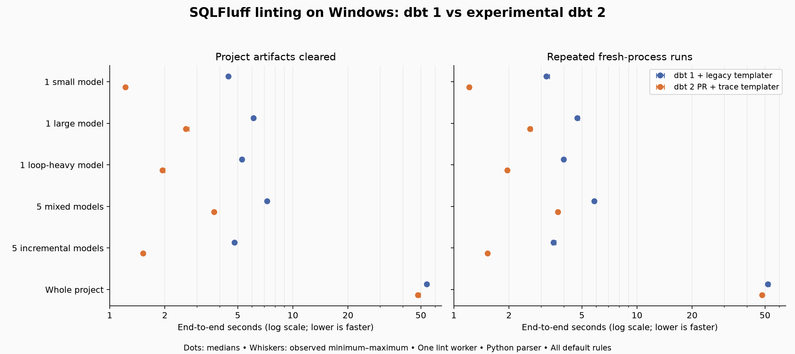

SQLFluff now has an experimental integration for the Rust-based dbt 2 runtime:
`sqlfluff-templater-dbt2`.

The new templater brings SQLFluff's linting workflow to dbt 2 projects, using SQL
rendered by dbt itself and mapping diagnostics back to your model files. It also
reduces the wait for lint results: in our local benchmark, elapsed time fell by
**45–62% for individual models**, **37–56% for five-model selections**, and **7%
for a complete 100-model project**.

## How it works

Linting a dbt model involves more than reading SQL. Functions such as `ref()`,
project macros, loops and conditionals determine the query that reaches the
parser. SQLFluff also needs to know how that rendered query relates to the
source file you edit.

The existing dbt templater works with the Python compiler in dbt Core 1.x. The
new integration uses dbt 2's render-trace interface, introduced through the
[upstream dbt change](https://github.com/dbt-labs/dbt/pull/16870) and the
[SQLFluff integration](https://github.com/sqlfluff/sqlfluff/pull/8854).

In the normal CLI workflow, the templater compiles the selected models together,
then reuses their render traces for that lint pass. Those traces connect rendered
SQL to its original source, including output from branches and loops. SQLFluff
can report diagnostics against model files and apply fixes where the source
mapping supports them.

## What we measured

We compared the existing dbt Core 1.x templater with the new dbt 2 integration
using a synthetic DuckDB project containing **100 models and 8,825 source lines**.

The project included small models, large queries with multiple CTEs and joins,
window functions, macros, templated loops, ephemeral dependencies, incremental
models and `dbt_utils` calls.

These are median whole-command times with project artifacts retained between runs:

| Workload | dbt 1 + existing templater | dbt 2 + new templater | Less elapsed time |
|---|---:|---:|---:|
| One small model | 3.20s | 1.21s | 62% |
| One large model | 4.72s | 2.61s | 45% |
| One model with extensive loop rendering | 3.98s | 1.95s | 51% |
| Five mixed models | 5.85s | 3.70s | 37% |
| Five incremental models | 3.50s | 1.53s | 56% |
| All 100 models | 51.94s | 48.14s | 7% |



Each result is the median of **seven measured runs per runtime and scenario**.
We tested six workloads under two artifact conditions, giving **168 timed runs**
in total. Every sample launched a fresh SQLFluff process; warm-up and correctness
checks were excluded.

With project target and log artifacts cleared before each run, the differences
were larger. The mixed five-model selection fell from **7.23 to 3.71 seconds**,
while the complete project fell from **53.78 to 48.27 seconds**, a **10%
reduction**. We did not flush operating-system filesystem caches.

### Why is the whole-project improvement smaller?

Much of the gain on a small selection comes from reducing initialization and
templating overhead. Both integrations share project setup across the selected
files, so checking 100 models pays that setup cost once.

For the complete project, about **45 of dbt 2's 48 seconds** went into SQLFluff's
lexer, parser and rule checks. Both configurations used the same Python parser
and one lint worker. Those shared stages account for most of the larger workload.

The absolute saving therefore grows—from about two seconds for a small selection
to nearly four seconds for the whole project—but represents a smaller percentage
of the total.

### Benchmark scope

Measurements were collected on 7 November 2026, using pre-release PR builds. Both
configurations used the same SQLFluff code revision, Python 3.13.15, default rules
and one lint worker on a Windows 11 desktop with an Intel Core i5-12400F and 64 GB
of RAM. The baseline used dbt Core 1.12.6; dbt 2 was built locally with its
optimized release profile. The project used DuckDB 1.5.4 and `dbt_utils` 1.3.3.

All 100 final models produced equivalent query results, and their lint diagnostics
matched between runtimes. During preparation, some block-indented loop and capture
variants exposed inconsistent or duplicate `LT02` indentation diagnostics in the
experimental consumer. We excluded those original variants from both sides and
replaced them with ten inline-loop models, retaining 100 models and substantial
macro and conditional rendering.

These results describe that compatible workload. They do not establish complete
templater parity or predict performance for other warehouses, parallel linting
configurations or persistent editor processes.

[Download the timings and ranges](summary.csv), or the
[methodology, inputs and reproduction bundle](benchmark-evidence.zip).

## Install the integration

Use the package that matches your dbt runtime:

| dbt runtime | SQLFluff plugin | Configuration |
|---|---|---|
| Python dbt Core 1.x | `sqlfluff-templater-dbt` | `templater = dbt` |
| Rust-based dbt 2 with render-trace support | `sqlfluff-templater-dbt2` | `templater = dbt2` |

For dbt 2, start in a separate Python environment so you can try the integration
alongside an existing dbt 1 setup.

From your project directory, create an environment:

```sh
python -m venv .venv-dbt2
```

Activate it with `source .venv-dbt2/bin/activate` on macOS or Linux, or
`.venv-dbt2\Scripts\Activate.ps1` in Windows PowerShell.

Install the current compatible releases:

```sh
python -m pip install --upgrade "dbt-core>=2,<3" sqlfluff-templater-dbt2
```

The templater installs its compatible SQLFluff dependency. Your dbt release must
include the render-trace API; an older dbt 2 installation without that feature
is insufficient.

Check the installed versions:

```sh
dbt --version
sqlfluff --version
```

Use your dbt 2 runtime's normal adapter, driver and profile configuration, and
resolve project packages with `dbt deps`. Your project should compile successfully
with that runtime before you use it through SQLFluff.

## Configure SQLFluff

Create or update `.sqlfluff` in your dbt project root. This DuckDB example assumes
that `dbt_project.yml` and `profiles.yml` are both in that directory:

```ini
[sqlfluff]
templater = dbt2
dialect = duckdb

[sqlfluff:templater:dbt2]
project_dir = .
profiles_dir = .
timeout = 300

# Optional overrides:
# profile = my_profile
# target = dev
```

Set `dialect` to your project's SQL dialect. If your profiles live elsewhere,
point `profiles_dir` to that directory—for example, `~/.dbt`.

When switching an existing configuration, move the relevant settings from
`[sqlfluff:templater:dbt]` into `[sqlfluff:templater:dbt2]`.

By default, the plugin uses dbt from the active Python environment. If you use
a separately installed, trace-capable dbt CLI, select it explicitly by adding
this setting under `[sqlfluff:templater:dbt2]`:

```ini
runtime_path = /absolute/path/to/dbt
```

## Lint your models

Save your model files, then lint one model:

```sh
sqlfluff lint models/orders.sql
```

Or check the complete models directory:

```sh
sqlfluff lint models
```

The templater handles compilation and trace generation automatically. You do not
need to prepare trace files yourself. For a selected batch, pass its model paths
together in one command so they can share the compilation.

To apply supported fixes to a model:

```sh
sqlfluff fix models/orders.sql
```

Compilation uses your project's dbt context and can make warehouse queries for
introspective macros. The initial integration works with saved model files on
disk; unsaved editor buffers and complete compatibility across all adapters and
templating patterns remain areas for further work.

Try the integration on a small selection first, then compare repeated runs on
your own project. We would welcome feedback on real workloads, particularly
examples that help extend source mapping and adapter coverage.
