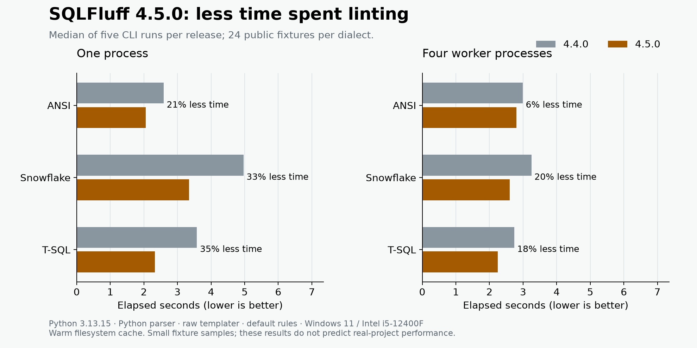

[SQLFluff 4.5.0](https://github.com/sqlfluff/sqlfluff/releases/tag/4.5.0) makes
layout linting faster by cutting repeated work. If your queries have wide SELECT
lists, many CTEs or plenty of layout violations, there's less work between you
and your lint results.

## What changed?

Several layout rules previously searched the same parts of a query repeatedly.
Those searches became increasingly expensive as queries grew. The release
replaces them with direct lookups and cached positions, and lets layout rules
reuse work on an unchanged file instead of rebuilding it for each rule.

Alongside these changes, 4.5 reduces per-file setup costs and sends less data
between worker processes. You can benefit with the Python parser; switching to
the optional Rust engine isn't required.

## How much time does it save?

In our comparison of **4.4.0 and 4.5.0**, median total lint time fell by
**21–35% with one process** across three public fixture samples. With four
workers, the reductions ranged from **6–20%**. These are whole-command timings,
covering all release changes, rather than an isolated measurement of layout rules.



We used 72 files—24 each for ANSI, Snowflake and T-SQL—with the Python parser,
raw templater and default rules. Each result is the median of **five measured
runs per release and scenario**, after one warm-up: 60 measured runs in total.
Both releases used Python 3.13.15 and identical dependencies on the same Windows
11 desktop.

These small samples illustrate the improvement, rather than predict your
project's runtime. Background activity introduced variability; the small ANSI
four-worker difference needs a quieter rerun before drawing a firm conclusion.
We haven't measured a real project or dbt/Jinja rendering in this comparison.

[Download the timings and ranges](summary.csv),
[the SVG chart](performance.svg), or
[the full methodology, inputs and reproduction bundle](benchmark-evidence.zip).

## When will you notice it most?

We expect the biggest benefits where **layout checks account for a large share
of the work**: wide SELECT lists, many CTEs, long sequences of statements and
numerous layout violations. Smaller per-file savings can also accumulate when
checking many files repeatedly in development or CI. These are expectations
based on the implementation, not additional measurements from our experiment.

The difference may be less visible when linting just a few tiny files, when
the relevant layout rules are disabled, or when project loading and rendering
dominate the wait. More workers aren't always better for small batches: four
workers took longer than one process on our ANSI sample in both releases.

There is complementary evidence from larger workloads. The
[reflow reuse PR](https://github.com/sqlfluff/sqlfluff/pull/8804) reported an
18% reduction in parallel `fix` time on 565 T-SQL files, and the
[worker communication PR](https://github.com/sqlfluff/sqlfluff/pull/8769)
reported 22% on 567 files. Those used Python 3.14, the Rust parser and eight
workers, and measured separate changes against different baselines. Their
percentages shouldn't be added together or to our results.

## Try it on your project

Upgrade using your normal dependency manager. For a standalone pip installation:

```sh
python -m pip install --upgrade sqlfluff
sqlfluff lint path/to/your/sql
```

For pre-commit, update the hook revision to `4.5.0`. Check templater-plugin
compatibility before upgrading, and compare repeated runs with the same SQL,
configuration, Python version, parser and process count.

See the [release notes](https://github.com/sqlfluff/sqlfluff/releases/tag/4.5.0)
for the full set of changes. Thank you to
[Josh Markovic](https://github.com/joshmarkovic),
[keraion](https://github.com/keraion), and everyone who helped implement,
test and review the performance work.
